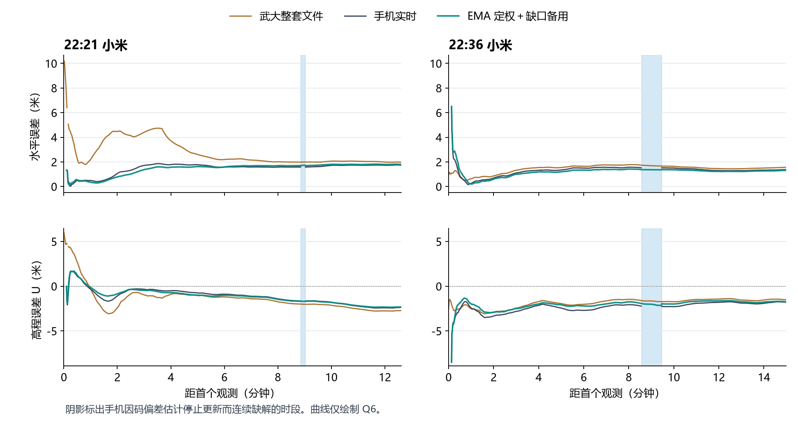

# 小米 22:21 与 22:36 两次手机 PPP 采集

2026-11-19 北京时间。两段最长缺解均由武大码偏差估计停止推进触发。PC 私有回放用采集前已有的武大当日码偏差作独立备用，补回了全部 10＋54 个连续缺失历元。保留正式定权时，手机原有的 739＋830 个 Q6 的位置可逐期原样保留。换成已冻结的 E41 单星单频 EMA 定权后，第二段在原有 830 个 Q6 上的水平／高程 RMS 分别从 1.354／2.382 米降到 1.270／2.090 米。第一段高程仅改善 0.0025 米。整套武大轨钟偏差文件在第二段改善高程，在第一段水平和高程均退步。部署状态为 PC 私有实验，手机当前仍运行采集时版本。

## 同时刻精度

两组各取正式实时解、EMA 加缺口备用、完整文件和同起算文件均为 Q6 的 GNSS 时间戳。第一段共 737 期，第二段 830 期。表中 H／U 为水平／高程 RMS，单位为米。覆盖按各自完整采集计分。两段保存了相同的用户配置 WGS84 椭球高参考，仅供解后 ENU 投影。

| 处理方式 | 22:21 H／U | Q6 / 758 | 22:36 H／U | Q6 / 900 |
|---|---:|---:|---:|---:|
| 手机实录三流，按应用顺序回放 | 1.543／1.412 | 739 | 1.354／2.382 | 830 |
| 正式定权＋独立备用，仅补缺口 | 1.543／1.412 | 749 | 1.354／2.382 | 884 |
| E41 冻结 EMA 定权＋同样备用 | 1.519／1.410 | 749 | 1.270／2.090 | 884 |
| 武大同批 RTS 文件，首观测起算 | 2.890／1.926 | 753 | 1.470／1.930 | 895 |
| 相同 RTS 文件，延至实时路首次调用滤波器 | 2.717／1.959 | 747 | 1.520／2.019 | 887 |



第一段文件解比手机实时解水平差 1.347 米，高程差 0.514 米。第二段文件解高程好 0.452 米，水平差 0.117 米。把文件滤波器延至实时路开始后，第二段高程仍好 0.362 米。文件的 0 秒首解使用事后齐备的产品。实时及两种补缺方案的首解分别是 6 秒和 8 秒。覆盖与精度分母见[汇总表](summary.csv)，曲线原值见[逐历元配对](epochs_paired.csv)。

## 两次缺解的原因

| 北京时间 | 轨钟／广播／偏差有效 RTCM 帧 | 原始 Q0／Q5／Q6 | 最长连续缺解，相对首观测 | 逐星检查 |
|---|---:|---:|---|---|
| 22:21 | 703／25,665／1,053 | 16／3／739 | 第 532–541 秒，10 期 | 283 个星次因码偏差估计未推进，30 个星次缺少组件 |
| 22:36 | 835／29,816／1,136 | 65／5／830 | 第 514–567 秒，54 期 | 1,389 个星次因码偏差估计未推进，162 个星次缺少组件 |

两个窗口内三路均有字节进入应用前缀，两段六路 CRC 错误均为零。第二段 54 期手机都显示“缺轨道／钟差／码偏差”，因为状态取决于遍历到的被拒卫星，掩盖了大多数卫星的拒绝原因。逐星复核表明，码偏差流重复发送已有估计，超过正式的 305 秒推进监视窗口。保留原轨钟、SNIP 广播、到达前缀、IOD、健康与天线检查，单独用有效文件码偏差即可补齐两个窗口。第二段广播确有一次 EOF，发生在会话约第 773 秒。偏差通道的两次读取超时分别在约第 72、805 秒，两次 404 重试也发生在第一个超时之后。它们均与 54 期连续缺解错开。[逐星诊断、传输事件与验证](verification.json)

## 两种改动各自的收益

- **补缺只处理连续性。** 主路维持正式滤波状态。备用路仅在已观测卫星触发码偏差估计不推进、该信号原有有效位存在、文件有该卫星和信号且当前处于记录有效期时，使用文件码偏差。主路提交 Q6 时优先采用主路。主路缺解且不足四颗改正卫星、当前历元确有该类拒绝、备用路有 Q6 时才选备用。只补缺时两段新增期 H／U 分别是 1.620／1.654 米和 1.506／2.317 米。主路原有 Q6 的坐标逐行相同。
- **EMA 对第二段有实际精度收益。** 沿用 E41 的 B1，仅按当前及历史的去组中位数码新息调整该星该频槽的码权，未重新拟合参数。第二段原 830 期中，826 期的绝对高程误差没有增大。在第一段原 739 期上，H／U 从 1.5422／1.4133 变为 1.5178／1.4108 米，481 期的绝对高程误差反而增大。第一段末 60 秒水平 RMS 从 1.740 升到 1.805 米。两段平均高程仍偏低，实际物理误差来源尚未唯一分离。
- **EMA 与补缺同时使用。** 两段的新增期 H／U 分别为 1.721／1.677 米和 1.365／2.040 米。进入／退出备用的相邻三维位置变化分别为 0.022／0.038 米和 0.015／0.203 米。原有历元上的精度收益来自 EMA，加入备用仅为新增期提供位置。
- **两个排除对照。** 同一套实时轨钟下，将可用卫星的实时码偏差都改为文件值并补缺，原有 Q6 的 H／U 为 1.555／1.420 和 1.347／2.416 米。此前在 11:20 小米单包见效的独立状态接管方案，在这两段的 H／U 分别为 1.314／2.842、1.658／2.555 米。两个新包的高程均出现退步。[各方案全集与同键差异](summary.csv)

## 产品和有效范围

广播挂载为 SNIP 的 RTCM3EPH，实时轨钟为 SSRC00WHU0，独立码偏差为 OSBC00WHU1。备用码偏差使用此前于北京时间 19:01 下载的武大 RTS 日文件。与事后同日较新版逐项核对，861 条码记录的卫星、信号、有效期和数值完全相同。与两段健康实录流中同星同信号的改正按正确符号比较，中位绝对差约 3 毫米，最大 3.23 厘米。此文件在 PC 上采集前已取得，采集手机未配置这个备用来源。

整套文件取武大 PRIDE 镜像 GPS 周 2445 的 WUM0MGXRTS_20263230000 同批 SP3、CLK、BIA。实际轨道截至 14:55 GPST，钟差截至 14:58:30 GPST。两次观测覆盖 14:21:20–14:33:57、14:36:53–14:51:52 GPST。观测附近轨道 300 秒一格，钟差多数为 30 秒一格，有一个 60 秒间隔。采用 BKG 当日合并广播导航、官方 IGS20 天线文件、各包自身预报 IONEX 和 VMF3。旧镜像的实时归档钟差只到 12:58:30，先前 FTPGet 的 NRT 轨道只到 12:55，均已排除。[产品范围与来源](products_used.json) · [武大产品发布说明](https://lists.igs.org/pipermail/igsmail/2026/008720.html) · [文件哈希](verification.json)

完整文件实验按每信号码偏差的实际有效期准入。文件载波以浮点模糊度估计，手机路径保留通过连续性检查的可选实时相位偏差。RTS BIA 未声明各星座钟参考信号，文件解沿用该入口现行参考约定。原生预检零错误，报告了产品时间网格、部分信号缺码偏差或天线校准、偏差文件未声明时标等警告。表中差异评价两条实际处理链，无法归于单一轨道或钟差误差。另修复了私有预检对空“生成程序”字段的解析，按 RINEX 固定栏正确读出 igs20.atx。修复前后四组文件回放的所有位置字段逐项相同。[预检修正](clock_header.patch)

## 复核与交付

两份原始 ZIP 校验后分别导入。全量 1,658 个观测历元按手机 recorded applied sequence 回放，逐历元释放数一致。两个正式回放的准入观测文件分别与手机逐字节相同。成功提交的 Q5、Q6 时间及状态逐一匹配，Q6 坐标复现的最大三维差约 1.1 微米。正式构建清单 9 个二进制匹配，两包各 26 个输入哈希通过。冻结 EMA 的准入观测、改正诊断与正式回放逐字节相同。禁用权重改动的匹配构建精确复现正式解。EMA 及备用滤波器在所有最终 Q6 的位置更新闭合误差最大 5.25×10⁻¹⁰ 米。所有评分仅使用已提交解，沿用显式电离层、非组合、浮点模糊度和 Joseph 更新。[核验程序](verify.py) · [核验数值](verification.json)

PC 私有目录每段的 recovered.csv 保存正式优先的补缺解，ema_recovered.csv 保存 EMA 加补缺解。两者逐行带有主路或备用来源标记。两路在同一历元各自按原前缀计算，PC 通过按历元合并生成结果。手机实时双路的计算耗时、备用产品下载和真机部署尚待验证。使用已有原生输出复算第二段的命令如下，输出路径须为新文件。

```powershell
python -B recover.py 2236/B1_ema_only_v2/solution.csv 2236/ema_gap_v2/solution.csv 2236/SSR/corrections.csv 2236/ema_gap_v2/sat_gate.csv 2236/ema_recovered_again.csv
```
