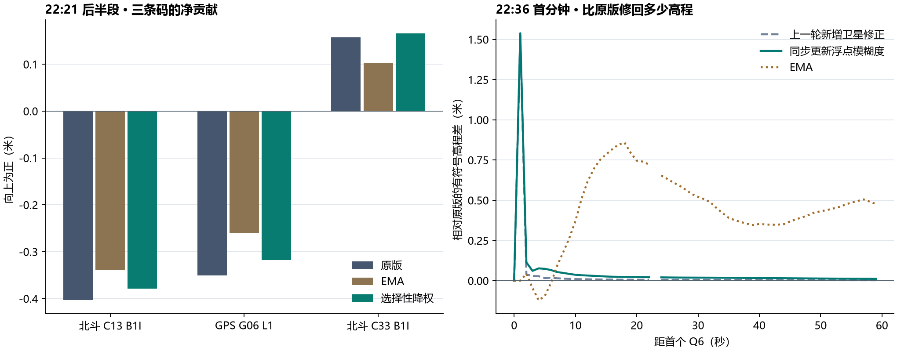

# 小米 22:21 异常码定权与 22:36 启动高程回拉

**22:21 的 C13 B1I 主要表现为持续负码新息，G06 L1 C/A 主要表现为较小的正新息乘上较大的负垂向增益。** 选择性降权保住了 C33 的向上贡献，并将 22:21 末分钟水平／高程 RMS 分别改善 5.0／3.2 厘米，整个后半段的高程 RMS 却退化 2.2 厘米。**22:36 启动回拉同时来自 Galileo E27 等卫星的码，以及北斗 C27 等卫星的相位。** 同步更新相位的浮点模糊度后，相位回拉几乎消失，但码回拉增大。首分钟高程较原版改善 6.5 厘米，较上一轮新增卫星方案多改善 1.9 厘米；米级收益仍仅限于修正当秒。两项均为 PC 研究结果，手机保留现行版本。

## 22:21 · 从码新息、权重和增益解释下拉

表中统计 367 个共同 Q6 的后半段。对每条码，用该历元其他全部观测预测它，得到条件留一新息。R 是实际码方差，R 比值以同历元、同星座及同信号的其他卫星方差中位数为分母。垂向增益表示 1 米码新息使位置向上变化多少米，符号由几何及滤波协方差共同决定。两类比值先逐行计算、再取时间中位数。

| 原版码观测 | 留一新息中位数 | 标准化中位数 | R 中位数 | R／同组 | 垂向增益绝对值／同组 | 净垂向贡献 |
|---|---:|---:|---:|---:|---:|---:|
| 北斗 C13 B1I | −3.722 m | −0.990 | 14.205 m² | 0.74 倍 | 2.03 倍 | −0.404 m |
| GPS G06 L1 C/A | +0.740 m | +0.386 | 3.638 m² | 0.25 倍 | 4.41 倍 | −0.351 m |
| 北斗 C33 B1I | +30.066 m | +2.000 | 264.697 m² | 17.05 倍 | 0.09 倍 | +0.157 m |

C13 在 366 行中有 84.4% 的留一新息为负。把后半段按时间等分为四段，其中位数依次为 −3.40、−5.35、−5.93、+0.84 米。最后一段方向反转，净向上 0.021 米。G06 的 360 行中有 79.2% 为正，四段留一中位数均为正，配合负垂向增益，四段都向下。两星均无单历元超过 2 个条件标准差的样本。C13 的证据支持码相对其他观测及模型有持续偏离；G06 的影响则对增益格外敏感。这里测得的是带偏差的观测与预测之差。手机多路径、码硬件偏差、残余大气和状态预测误差尚不能分别定量；相对同组权重较高也不能单凭这一点认定其标称噪声错误。[留一新息、方差和增益明细](target_diagnostics.csv) · [后半段四个等时子窗](target_quarters.csv)

用 EMA 作配对验证。对相同码行，将实际垂向更新变化精确拆成“平均增益 × 新息变化”和“平均新息 × 增益变化”。G06 的净下拉减少 0.091 米，其中 **0.086 米来自增益变化，0.005 米来自新息变化**；C13 减少 0.065 米，两项分别为 0.035、0.031 米。增益也受几何和状态协方差影响。独立冻结各历元预测与其他码，仅将该行 R 乘 4，原版下 C13／G06 对当期垂向解变化的逐期累计为 +0.303／+0.264 米，C33 为 −0.118 米。该数值是单行权重敏感度，实际时间序列的精度收益见全长回放。[增益与新息的配对分解](gain_vs_innovation.csv)

### 选择性降权是否保住 C33

在线只使用当前与过去的条件标准化新息。每个卫星频槽最多保留 20 个已提交 Q6 的同信号样本，间隔超过 2 秒、换码或滑移会清空历史。需要至少 12 个历史样本、至少 75% 与当前同号、历史截幅均值绝对值及当前绝对值都达到 0.5，同时有至少 3 个同组其他卫星，且自身 R 不高于同组中位数。符合时把该行 R 乘以 1 加历史均值平方的两倍，倍率上限为 4。该规则同时检查统计偏离与既有权重，未指定卫星编号或垂向贡献方向。若记新息精度矩阵为 J，即新息协方差的逆矩阵，条件留一新息为 (Jv)ᵢ/Jᵢᵢ，条件标准差为 1/√Jᵢᵢ；同一编辑试算内各行均在加权前计算。

| 22:21 后半段 | 原版净贡献 | EMA 净贡献 | 选择性降权净贡献 | 实际降权行数 |
|---|---:|---:|---:|---:|
| C13 B1I | −0.404 m | −0.338 m | −0.378 m | 82 |
| G06 L1 C/A | −0.351 m | −0.259 m | −0.318 m | 126 |
| C33 B1I | +0.157 m | +0.103 m | +0.166 m | 0 |

后半段共调整 291 个历元的 508 行码。G06 的增益变化本可减少 0.131 米下拉，同期新息变化又抵消 0.098 米，实际净减 0.032 米。整段伪距从原版净推低 1.661 米变为净推低 1.523 米。新方案进入后半段时高程已低 1.066 米，原版低 0.938 米；因此后半段继续下降的幅度变小，后半段总体高程 RMS 仍由 1.814 增至 1.835 米。C33 全包均未被本规则额外降权。[逐期降权动作](actions.csv) · [动作统计](action_summary.csv)

## 22:36 · 哪些码和相位抵消了启动修正

沿用上一轮首次新增卫星修正作为第三个对照。首个 Q6 后第 1 秒它比原版向上修回 1.524 米，下表比较**紧接着的第 2 秒**。数值是各条实际提交观测的有符号垂向更新，单位米。差值为上一轮方案减原版，因此也包括原本向上的贡献变弱。完整表保留编辑后仅一方有该行的情况。

| 观测 | 原版 | EMA | 上一轮启动修正 | 上一轮减原版 | 同步浮点模糊度 |
|---|---:|---:|---:|---:|---:|
| 码 E27 5Q | -0.043 | -0.044 | -0.343 | -0.300 | -0.588 |
| 码 E27 1C | -0.126 | -0.126 | -0.403 | -0.277 | -0.597 |
| 码 E15 5Q | -0.089 | -0.089 | -0.282 | -0.193 | -0.464 |
| 码 C28 5P | -0.033 | -0.032 | -0.180 | -0.148 | -0.328 |
| 相位 C27 2I | -0.000 | +0.000 | -0.386 | -0.385 | +0.001 |
| 相位 C27 5P | +0.000 | -0.000 | -0.356 | -0.356 | -0.001 |
| 相位 C13 2I | -0.001 | -0.001 | -0.117 | -0.116 | -0.002 |
| 相位 E21 5Q | +0.000 | +0.000 | +0.164 | +0.164 | +0.000 |

在上一轮方案中，E27 两条码合计较原版多下拉 0.577 米，C27 两条相位合计多下拉 0.741 米，另有 E21 5Q 相位向上抵消 0.164 米。所有码合计 −0.949 米、所有相位 −0.658 米，电离层约束向上 +0.197 米，位置当秒下降 1.410 米。[全部卫星码和相位的增益、新息与净贡献](rebound_rows.csv)

本轮启动方案在同一次联合更新中，把新增卫星估计出的垂向位移，同时映射给该次最终接纳相位的原有浮点模糊度。模糊度位移系数取相位几何对垂向偏导的相反数，使位置坐标改变时，几何距离与相应模糊度的合计预测连续。均值、交叉协方差和 Joseph 协方差按同一个线性映射计算。其他码、大气、钟差及既有残差编辑继续参与。22:36 的最终提交包含 18 条这样的相位弧（当期第 1 次试算通过，上一轮是第 13 次），22:21 为 10 条。

22:36 下一秒的相位净下拉从 −0.658 缩至 −0.004 米，但码从 −0.949 增至 −1.563 米。相对原版的高度优势在修正当秒为 1.539 米，下一秒为 0.114 米，第 10 秒为 0.037 米，第 59 秒为 0.012 米。上一轮对应为 1.524、0.039、0.010、0.003 米。由此可以确认相位一致性修正有效，剩余回拉主要通过码进入。首分钟高程较 EMA 仍差 0.274 米，水平较 EMA 好 0.255 米。22:21 原来的首个高程误差 −0.02024 米逐字段重现。[逐期高程与水平](startup_epochs.csv) · [垂向收支](vertical_budget.csv)

## 同一历元的精度与交付判断

每格为水平 RMS／高程 RMS，单位米。首分钟从原版首个 Q6 起取 60 秒，末分钟以最后原始历元为界，后半段从原始采集时间中点起算。两项改法各在两个包单独全长运行。

| 采集 | 窗口 | 共同 Q6 | 原版 | EMA | 上一轮新增卫星 | 选择性码降权 | 同步浮点模糊度 |
|---|---|---:|---:|---:|---:|---:|---:|
| 22:21 | 首分钟 | 60 | 0.516／1.007 | 0.490／1.039 | 0.516／0.993 | 0.551／0.978 | 0.516／0.990 |
| 22:21 | 后半段 | 367 | 1.659／1.814 | 1.745／1.805 | 1.659／1.814 | 1.586／1.835 | 1.659／1.814 |
| 22:21 | 末分钟 | 59 | 1.740／2.408 | 1.805／2.329 | 1.740／2.408 | 1.690／2.376 | 1.740／2.408 |
| 22:21 | 全段 | 739 | 1.542／1.413 | 1.518／1.411 | 1.542／1.413 | 1.415／1.419 | 1.542／1.413 |
| 22:36 | 首分钟 | 59 | 1.617／2.957 | 1.873／2.617 | 1.617／2.911 | 1.596／2.897 | 1.617／2.892 |
| 22:36 | 后半段 | 392 | 1.399／1.962 | 1.301／1.760 | 1.399／1.961 | 1.293／1.715 | 1.399／1.961 |
| 22:36 | 末分钟 | 59 | 1.350／1.790 | 1.288／1.714 | 1.350／1.789 | 1.251／1.552 | 1.350／1.789 |
| 22:36 | 全段 | 830 | 1.354／2.382 | 1.270／2.090 | 1.354／2.377 | 1.253／2.200 | 1.354／2.374 |

选择性降权在 22:21 的全段水平改善 0.127 米，但全段高程退化 0.005 米。交叉验证的 22:36 全段水平／高程改善 0.101／0.182 米，高程仍落后 EMA 0.109 米。同步更新浮点模糊度的可复现收益集中在启动，22:36 全段高程比原版仅改善 0.008 米。两次同一台小米的实录支持继续在 PC 研究持续码偏与权重分配，现有结果不足以更新手机配置。[所有窗口相对原版、EMA、上一轮的完整差值](accuracy.csv)

两包各跑原版、EMA、上一轮启动方案和两个独立新方案，共 10 次主回放，另有 2 次只读增广状态复核。原版、EMA 和上一轮启动对照的非耗时解字段逐期完全复现。22:21 五方案均为 739／758 个 Q6，22:36 均为 830／900 个 Q6，逐期 Q 序列完全一致。观测、改正日志逐字节相同，146 项哈希守卫通过。逐行增益乘新息及整笔 Q6 更新分别核对，最大三维更新闭合差小于 5.25×10⁻¹⁰ 米。独立显式增广解的最大状态分量差小于 1.17×10⁻¹²，按状态标准差乘积缩放的最大协方差差小于 1.48×10⁻¹⁵。参考位置仅用于解后评估和归因投影；两种解算均保持非组合、显式电离层、浮点模糊度。[回放核验](verification.json) · [增广核验](joint_check.json) · [私有构建](probe.py) · [观测诊断与降权](reason.inc) · [解后归因](analyze.py) · [增广复核脚本](check_joint.py) · [作图脚本](plot.py)
