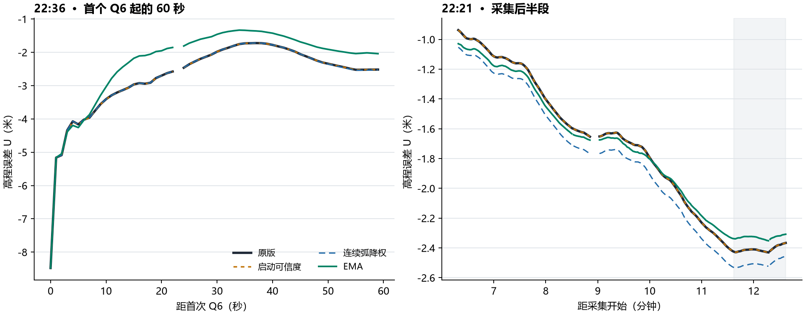

# 小米 22:36 首解高程与 22:21 后半段漂移的 PC 隔离验证

**两种新改法都未达到各自的高程目标，手机保留现行版本。** 22:36 的启动可信度方案把首解高程误差从 −8.47694 米改为 −8.47565 米，只收回 1.3 毫米。22:21 的连续弧降权方案把末分钟高程 RMS 从 2.408 米增至 2.504 米，水平只改善 0.011 米。原参数 EMA 在 22:36 的全段水平、高程分别改善 0.084、0.291 米，但首分钟水平退化 0.256 米。两包均为同一台小米的现场实录。

## 相同历元上的水平和高程

每格为水平 RMS／高程 RMS，单位米，越小越好。水平使用东、北两向误差的平方和，高程保留相对包内参考点的符号用于漂移分析。首分钟从原版首个 Q6 起算 60 秒，末分钟从最后一个原始历元向前取 60 秒，后半段从原始首末时刻的中点起算。先按精确 GPS 周、周内秒对齐四种方案，再仅在共同 Q6 上计分。

| 现场时间 | 窗口 | 共同 Q6 | 原版 | EMA | 启动可信度 | 连续弧降权 |
|---|---|---:|---:|---:|---:|---:|
| 22:21 | 首分钟 | 60 | 0.516／1.007 | 0.490／1.039 | 0.516／1.004 | 0.510／1.008 |
| 22:21 | 后半段 | 367 | 1.659／1.814 | 1.745／1.805 | 1.659／1.814 | 1.653／1.917 |
| 22:21 | 末分钟 | 59 | 1.740／2.408 | 1.805／2.329 | 1.740／2.408 | 1.729／2.504 |
| 22:21 | 全段 | 739 | 1.542／1.413 | 1.518／1.411 | 1.542／1.413 | 1.541／1.498 |
| 22:36 | 首分钟 | 59 | 1.617／2.957 | 1.873／2.617 | 1.617／2.959 | 1.616／2.958 |
| 22:36 | 后半段 | 392 | 1.399／1.962 | 1.301／1.760 | 1.399／1.962 | 1.381／2.081 |
| 22:36 | 末分钟 | 59 | 1.350／1.790 | 1.288／1.714 | 1.350／1.790 | 1.335／1.896 |
| 22:36 | 全段 | 830 | 1.354／2.382 | 1.270／2.090 | 1.354／2.382 | 1.337／2.458 |

[各方案相对原版、EMA 的精确差值及首解指标](matched_windows.csv) · [带 GPS 历元键的逐期相对误差](common_epoch_errors.csv)

曲线只连接连续的共同 Q6。左图几乎重合的原版与启动方案反映实际差距，右图阴影为最后 60 秒。

## 22:36 的启动可信度

第一步用首个已接纳单点解的观测、权重和几何，在最终线性化点重算逐星留一的垂向敏感度。22:36 的最大变动为 6.919 米，22:21 为 7.087 米，两者都复现了先前独立的留一诊断。估计器仅给当前位置协方差的当地向上方向增加相应方差，幅度上限为 15 米的平方。第二步在首个单点解后 10 秒内，检查三个连续单点解相对初值的垂向变化。三期极差不超过门限、变化中位数的绝对值超过门限时，在下一个可提交的更新再放宽一次。门限取 1 米和首期留一变化一半中的较大值，新增标准差取留一变化、复核中位数绝对值及 15 米中的最小值。两阶段都只在 Q6 提交后消耗。复用同一批码产生的单点解仅用于检查一致性。

| 22:36 | 两次处理的时点 | 原版预测 σU → 后验 σU | 启动方案预测 σU → 后验 σU | 原版 U → 启动方案 U |
|---|---:|---:|---:|---:|
| 首个 Q6 | 采集后 8 秒 | 60.000 → 10.250 m | 60.398 → 10.252 m | −8.477 → −8.476 m |
| 三期复核后 | 采集后 11 秒 | 4.140 → 3.247 m | 8.063 → 3.254 m | −4.342 → −4.356 m |

原版首期垂向预测方差已达 3,600 平方米，增加 47.867 平方米对第一次更新影响很小。第二次复核确实检测到后续单点解向上移动，中位数为 +11.975 米。放宽位置方差并未为状态均值引入新的高程信息，测量更新后两种方案的垂向标准差只差 0.006 米。22:21 也触发了向上复核，中位数为 +7.424 米，但该包原版首个 PPP 高程只低 0.020 米。两次实测说明逐星敏感度和后续单点解的一致变化能提示启动条件，尚不足以确定首个 PPP 高程偏差的方向或给出经过校准的置信区间。[逐次预测、后验标准差和实际高程](startup_confidence.csv)

## 22:21 的连续弧降权

同一颗卫星两个有可用码、连续相位及 GIM 的频点分别保留改正后的码减相位时间序列，以首 5 期均值作锚点，并与最近 5 期均值比较。只使用至少 20 秒的连续观测，换信号、失锁或缺测会重建锚点。各频点按本频率扣除 GIM 预期项。用两条相位时间变化之差检查色散一致性，定位方程仍逐频使用非组合观测、显式电离层和浮点模糊度。

- 若相位变化之差绝对值不超过 0.15 米，且一频码漂移超过 2 米、另一频至多 1 米，只把异常频点的码观测方差乘以倍率。倍率为码漂移绝对值除以 2 米后的平方，上限为 9。
- 若两频推得的等效电离层变化同号，各自绝对值至少 0.5 米、彼此相差至多 0.5 米，且相位色散变化达到 0.1 米并在两频各自的 0.15 米容差内符合预测，则只放宽该星当期实际采用的 GIM 约束，倍率上限同为 9。

22:21 的 367 个后半段共同历元中，307 期有成熟的双频弧，302 期实际降低码权重，共 889 行。高程 RMS 比原版差 0.103 米、比 EMA 差 0.112 米。最后一分钟的**有符号平均高程**从原版 −2.408 米变为 −2.504 米，EMA 为 −2.329 米。连续弧降权在后半段首个共同历元已经低至 −1.053 米，结束时为 −2.456 米，原版对应为 −0.938、−2.366 米。末段绝对高程更差，而两个端点间的下降幅度约为 1.403 米与 1.429 米，两者应分别解读。

整段 22:21 和 22:36 分别有 1,396、1,553 行码方差被放大，两包实际放宽的电离层先验均为 **0 行**。这次可评估的动作是选择性码降权。对电离层先验单独放宽会带来多大影响，仍缺少有触发的样本。连续弧方案在 22:36 的末段高程也退化 0.106 米。[分窗口动作次数和最大倍率](action_windows.csv)

## 交付判断与复核

手机继续用现行版本。22:36 若继续做启动提精，优先验证新增卫星给出的独立高程信息能否在实时条件下校正均值，同时用 22:21 检查误修一个本已准确的首解。22:21 若继续追查下降，优先定位被降权码行原本对垂向更新的有符号贡献，查明哪些观测在抵消偏差。这两包未证实造成偏差的具体物理来源。EMA 保留为 PC 对照；在 22:21 它的全段高程收益只有 0.0025 米，末分钟水平退化 0.065 米。

两包各运行原版、冻结参数的单星单频 EMA、单独启动可信度、单独连续弧降权，共 8 次主回放；另作 4 次协方差只读复核。全部复用实录到达顺序和相应 WHU 实时产品，使用包内静止参考点作解后 ENU 评估。原版与 EMA 的 14 个非耗时解字段在各自原档案中逐历元完全复现。每次观测与改正日志均与相应原档案逐字节相同。22:21 的 Q0／Q5／Q6 为 16／3／739，22:36 为 65／5／830，原始历元总数 758 和 900；四方案逐期 Q 差异均为零，首次 Q6 分别为第 6 秒和第 8 秒。所有主回放已提交 Q6 的最大三维更新闭合差为 5.246×10⁻¹⁰ 米。123 项前后哈希守卫一致，涵盖 9 个正式二进制及每包 26 项输入。四次只读复核逐期重现对应解、动作及闭合数值。两包同属一台手机，跨设备推广仍缺验证。[核验记录](verification.json)

PC 复现时，在新的空验证目录中依次运行主回放、垂向协方差复核和解后统计。依赖原采集档案、既有 EMA 私有内核及闭合测量对象，正式构建与手机安装均沿用现场版本。[构建及回放](experiment.py) · [启动算法](seed.inc) · [连续弧算法](drift.inc) · [只读复核](uncertainty.py) · [解后评分](score.py) · [作图](plot.py)
