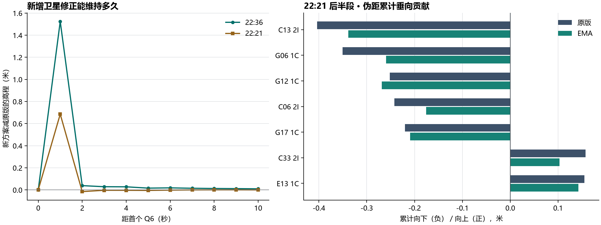

# 小米 22:36 新增卫星修正高程及 22:21 后半段逐星贡献

**22:36 的新增卫星把当秒高程向上修回 1.524 米，下一秒相对原版的优势降到 0.039 米。** 首分钟高程 RMS 改善 0.046 米，全段改善 0.005 米。22:21 原本只低 0.020 米的首个 Q6 逐字段复现，首次新增卫星到达时也有收益；首分钟高程 RMS 改善 0.013 米。22:21 后半段主要下拉来自 GPS L1 C/A 和北斗 B1I，贡献最大的两条是北斗 C13 B1I、GPS G06 L1 C/A。当前结果支持保留为 PC 启动研究候选，手机维持现行版本。

## 首分钟到底改善多少

每格为水平 RMS／高程 RMS，单位米，越小越好。每包按 GPS 周和周内秒精确对齐原版、冻结参数 EMA、新增卫星三种方案。首分钟从原版第一个 Q6 起算，末分钟相对原始采集末历元取 60 秒；后半段从原始首末历元的时间中点算起。

| 采集 | 窗口 | 共同 Q6 | 原版 | EMA | 新增卫星 |
|---|---|---:|---:|---:|---:|
| 22:36 | 首分钟 | 59 | 1.617／2.957 | 1.873／2.617 | 1.617／2.911 |
| 22:36 | 后半段 | 392 | 1.399／1.962 | 1.301／1.760 | 1.399／1.961 |
| 22:36 | 末分钟 | 59 | 1.350／1.790 | 1.288／1.714 | 1.350／1.789 |
| 22:36 | 全段 | 830 | 1.354／2.382 | 1.270／2.090 | 1.354／2.377 |
| 22:21 | 首分钟 | 60 | 0.516／1.007 | 0.490／1.039 | 0.516／0.993 |
| 22:21 | 后半段 | 367 | 1.659／1.814 | 1.745／1.805 | 1.659／1.814 |
| 22:21 | 末分钟 | 59 | 1.740／2.408 | 1.805／2.329 | 1.740／2.408 |
| 22:21 | 全段 | 739 | 1.542／1.413 | 1.518／1.411 | 1.542／1.413 |

22:36 第一个 Q6 出现在采集第 8 秒，当时高程低 8.477 米。第 9 秒新接纳 6 颗 Galileo E1C 卫星（E13、E15、E21、E27、E30、E34），该秒高程误差从原版的 −5.161 米收回到 −3.637 米。辅助垂向偏移本身估计为 +1.892 米，与原状态、钟和大气等同步更新后，最终解相对原版高 1.524 米。再过 1 秒，原版码、相位的垂向更新分别为 −0.120、+0.001 米，新方案分别为 −0.949、−0.658 米。两者电离层约束的垂向更新接近（+0.194、+0.197 米）。这一秒码和载波对位置的回调，解释了两条高程曲线为什么迅速靠拢。首个 Q6 后第 10 秒仅余 0.010 米优势。22:36 新方案首分钟高程比 EMA 差 0.293 米，水平比 EMA 好 0.256 米。[触发及卫星名单](startup_events.csv) · [启动 11 期的垂向更新](early_updates.csv)

22:21 第一个 Q6 出现在采集第 6 秒，三个方案的高程误差均为 −0.02024 米。第 7 秒有 5 颗此前未接纳的 Galileo E1C 卫星进入最终更新，原版高程低 1.605 米，新方案低 0.919 米，当秒改善 0.686 米。接下来一秒，新方案比原版多低 0.015 米，这也是首分钟内绝对高程误差最大的一次反退。首分钟新方案较原版改善 0.013 米，较 EMA 改善 0.045 米。末分钟高程相对原版的变化不足 1 毫米。[全部窗口及相对两种对照的差值](accuracy.csv) · [逐历元水平与有符号高程](matched_epochs.csv)

## 22:21 后半段是谁在下拉

367 个共同 Q6 中，原版有 13,713 条最终提交的伪距行，覆盖 40 个卫星与信号组合。每行将实际卡尔曼增益乘实际验前新息，投影到包内参考点的当地向上方向。下表把同一条信号历次向上、向下的贡献分别累加，单位米。负值表示它在这次解算中把滤波位置往下推。最后一列给出仅在启动使用新增卫星修正后的结果。

| 卫星与信号 | 原版向上 | 原版向下 | 原版净值 | EMA 净值 | 新增卫星净值 |
|---|---:|---:|---:|---:|---:|
| C13 2I | +0.049 | -0.452 | -0.404 | -0.338 | -0.404 |
| G06 1C | +0.060 | -0.410 | -0.351 | -0.259 | -0.351 |
| G12 1C | +0.104 | -0.355 | -0.252 | -0.269 | -0.252 |
| C06 2I | +0.002 | -0.245 | -0.242 | -0.176 | -0.242 |
| G17 1C | +0.101 | -0.321 | -0.220 | -0.210 | -0.220 |
| C27 2I | +0.010 | -0.201 | -0.191 | -0.158 | -0.191 |
| C33 2I | +0.164 | -0.007 | +0.157 | +0.103 | +0.157 |
| E13 1C | +0.172 | -0.017 | +0.155 | +0.143 | +0.155 |
| C23 5P | +0.095 | -0.000 | +0.095 | +0.103 | +0.095 |

按信号汇总，原版 GPS L1 C/A 净推低 0.846 米，北斗 B1I 净推低 0.719 米；同为北斗 B1I 的 C33 却向上托了 0.157 米。EMA 将 C13、G06 的净下拉分别减弱 0.065、0.091 米，同时 G12 的净下拉又增加 0.017 米。[全部 40 个卫星与信号组合，含频率 MHz、历元数、正负行数](second_half_signal.csv) · [分星座和频点汇总](second_half_frequency.csv)

原版伪距合计向上 +2.069 米、向下 −3.729 米，净值 **−1.661 米**。同一窗口的相位向上 +0.178 米，电离层约束向上 +0.210 米，对流层约束向下 −0.163 米，提交之间的其他变化约 +0.003 米。自进入窗口前最后一个共同 Q6 至采集结束，实际高程由 −0.933 降到 −2.366 米，共下降 1.433 米。EMA 的码净下拉为 −1.522 米，实际下降 1.282 米。这里的后半段严格按时间中点截取；先前“首分钟之后”的归因覆盖了更长的时段。逐行贡献反映实际增益和新息的共同作用；单靠这次分解无法判定某星存在固定码偏差，也无法把该行的净值直接换算为删星收益。[三种方法的全部垂向收支](second_half_budget.csv)

## 在线规则与验收

- 首个 Q6 后 60 秒内，仅允许一次新增卫星垂向修正，两个包使用相同规则。根据历次已提交更新的伪距卫星身份判断首次准入，每星取当前可用最低频槽的一条码。每个同星座、同信号组需至少 2 颗，按码方差加权的垂向几何系数标准差至少为 0.10，合计至少两个独立的组内对比。删星编辑重试会重新构造观测组，只记录最终提交。两包均在首个 Q6 后第 1 秒满足条件。
- 在一次联合滤波中增设零均值的瞬时垂向偏移，先验标准差取首期实时单点解逐星留一的最大垂向变化，上限 15 米。只有新卫星的码观测对偏移有直接灵敏度，灵敏度取原垂向几何系数减去同组加权均值。组内共同钟差与该系数在码权重下正交。其余观测正常约束原状态。在同一笔 Joseph 更新内同时求解原状态和偏移，将偏移均值与完整交叉协方差映射回输出位置。全程保持非组合、显式电离层、浮点模糊度。现场参考只在评分和更新投影时读取。[算法实现](new_sat.inc) · [PC 私有构建与回放](run.py)
- 两包各跑 3 个全长方案，共 6 次主回放。原版和 EMA 的 14 个非耗时字段均逐历元重现原档案。22:21 三方案均为 739／758 个 Q6，22:36 均为 830／900 个 Q6；逐期 Q 差异为零。所有回放的观测与改正日志均与对应原版逐字节相同，130 项前后哈希守卫一致，其中包括 9 个正式二进制、两包各 26 项输入。最终 Q6 的最大三维增益更新闭合差小于 5.25×10⁻¹⁰ 米，原版每条 Q6 增益更新均经前轮独立日志核对。[回放与闭合核验](verification.json) · [逐行归因与评分](score_rows.py)
- 另作两次只读回放，用实际提交矩阵显式增广一个状态，独立求解后再投影回原状态空间。两包均逐期复现新方案；增广解与私有内核的最大状态分量差小于 2.26×10⁻¹²，按状态标准差乘积缩放的最大协方差差小于 1.31×10⁻¹⁵。证据只覆盖同一台小米的两次采集。[独立增广复核](joint_check.json) · [复核脚本](cov_audit.py) · [作图脚本](plot.py)
