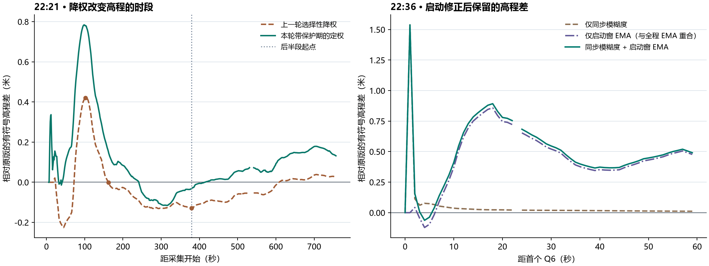

# 小米 22:21 后半段下沉与 22:36 首分钟回拉

**两项 PC 改法均为 PARTIAL_TRADEOFF。** 22:21 对已经低权的码保留保护期后，后半段水平／高程 RMS 比原版降低 **9.1／9.5 厘米**，比 EMA 降低 **17.7／8.6 厘米**。C33 B1I 保留原版 **97.8%** 的净向上贡献。22:36 保留新增卫星修正和浮点模糊度同步，仅在启动窗对历史波动超标的码降权，首分钟高程 RMS 比原版降低 **41.2 厘米**，比相同窗口的单独 EMA 再降低 **7.2 厘米**，其中新增卫星修正贡献 5.7 厘米，同步更新模糊度再贡献 1.5 厘米。22:21 首分钟两项精度均有回退，22:36 首分钟水平比原版差 **24.9 厘米**。本轮结论限同一台小米的两段实录，手机沿用现场版本。

## 22:21　多低的 12.9 厘米从哪里来

以下时间从采集开始计，首个 Q6 在第 6 秒。上一轮选择性降权从第 19 秒开始改变解，第 29 秒曾比原版低 10.6 厘米，第 45 秒低 22.5 厘米，随后反向升到第 102 秒的 **+42.0 厘米**。第 **162 秒**重新跌破原版，此后直到后半段开始均在原版下方。第 218 秒低 5.3 厘米，第 245 秒低 10.1 厘米，第 **379 秒**低 **12.9 厘米**。新方案在第 379 秒的高程误差为 −0.970 米，原版 −0.938 米，旧方案 −1.066 米，起点差距缩至 **3.3 厘米**。[转折历元](midpoint_onset.csv)

从第 102 秒峰值到第 379 秒，旧方案相对原版下降 54.92 厘米。其中码更新 −52.46 厘米，相位 +0.25 厘米，电离层先验 −3.56 厘米，对流层 +0.96 厘米，未由上述项解释的变化 −0.10 厘米。最陡的回落发生在第 102–162 秒，60 秒内下降 42.17 厘米。按码行累计，峰值至中点下拉最多的是 G22 L1 C/A（−20.6 厘米）、C13 B1I（−14.2 厘米）、C28 B1I（−8.2 厘米）、G06 L1 C/A（−8.1 厘米）。这些数值衡量两条滤波轨迹的垂向更新差，其他信号有反向抵消。[分段收支](midpoint_intervals.csv) · [逐星逐信号差值](midpoint_signals.csv)

处理沿用原选择性降权的连续同号留一新息检验，同时利用组内去中位数的码新息 EMA 估计每颗星每个频槽的波动。经验方差高于整行名义方差时才补充方差。名义方差已超过同系统同信号其他卫星中位数的码，额外增量按两者之比衰减，超过 4 倍时跳过。同组至少需 3 颗其他卫星。一次成功提交记录到 4 倍以上的低权码后，须连续 20 次恢复至同组中位数以内才解除保护；失锁、换码或间隔超过 2 秒重新建弧。该规则对所有卫星相同。下表为后半段码更新的净垂向贡献，单位米，向上为正。

| 信号 | 原版 | EMA | 旧选择性降权 | 新方案 | 新方案额外降权行数 |
|---|---:|---:|---:|---:|---:|
| C13 B1I | −0.404 | −0.338 | −0.378 | −0.340 | 137 |
| G06 L1 C/A | −0.351 | −0.259 | −0.318 | −0.277 | 131 |
| C33 B1I | +0.157 | +0.103 | +0.166 | **+0.154** | 6 |

去掉保护期，C33 的额外降权从 6 行升到 8 行，净向上贡献降至 +0.151 米，后半段水平／高程为 1.606／1.729 米。延迟启用经验方差的另一个方案后半段高程更好（1.684 米），水平却升至 1.713 米。本轮选择同时保住水平收益和 C33 正贡献的方案。C33 与旧选择性方案仍有 1.2 厘米的贡献差距。[全部后半段码贡献](late_code_signals.csv) · [实际额外降权行](weighted_codes.csv)

## 22:36　E27、E15 为什么在下一秒回拉

首个 Q6 高程误差 −8.477 米。1 秒后，新增卫星提供垂向修正，同步更新 18 个浮点模糊度，解比原版高 1.539 米。再过 1 秒，原版与同步方案使用的四条 Galileo 改正后码观测逐条相差小于 4×10⁻⁹ 米。位置状态变化使 E27 的几何预测项对新息贡献增加 **1.497 米**，E15 增加 **1.442 米**，接收机钟项再各贡献 **0.280 米**。四条码的垂向增益均为负，正新息因此把解往下拉。下表为仅同步方案在回拉历元的分解。

| 卫星与信号 | 验前新息（米） | 相对原版的新息差（米） | 垂向增益 | 垂向更新（米） | 单行留一标准化新息 |
|---|---:|---:|---:|---:|---:|
| E27 E1C | +2.332 | +1.771 | −0.256 | −0.597 | +0.303 |
| E27 E5aQ | +1.945 | +1.768 | −0.302 | −0.588 | +0.232 |
| E15 E1C | +0.202 | +1.723 | −0.118 | −0.024 | −0.513 |
| E15 E5aQ | +2.303 | +1.725 | −0.202 | −0.464 | +0.465 |

扣除其余观测后，对同星两条码联合检验。E27、E15 的卡方统计量为 **0.197、0.399**，两自由度 95% 门限为 **5.991**。按当秒联合异常降权，在整个首分钟只触发 4 行，首分钟高程 RMS 为 2.894 米，与仅同步的 2.892 米接近。逐行记录支持把回拉归因到几何、钟与增益的共同作用，未取得将这四条码判为粗差的证据。[同星检验、观测方程与增益分解](rebound_model.csv)

保留同步，用冻结的 EMA（系数 0.08，至少 3 次有效样本）识别波动持续超过码基准方差的行。EMA 从验前已到达数据学习，每历元学习一次。额外定权只在同步提交后的下一历元起、首个 Q6 后 60 秒内启用。回拉当秒仅 C27、C33 的 5P 码触发，这两条码的整行方差分别放大 4.03、6.52 倍。首分钟共触发 361 行、57 个 Q6，其中 E27 后续触发 5 行，E15 全窗 0 行。[触发统计](actions.csv)

首个 Q6 后第 1、2、5、10、30、59 秒，新方案相对原版的有符号高程差依次为 **+1.539、+0.156、−0.037、+0.411、+0.547、+0.491 米**。最初修正大部分仍在下一秒消退，第 5 秒优势短暂消失。只保留同一窗口的 EMA、记录同一新增卫星事件且关闭该事件的状态更新时，第 59 秒也已回升 +0.477 米。仅启动窗 EMA 的首分钟高程 RMS 为 **2.617 米**。在同一 EMA 窗口只加入新增卫星的垂向修正，得到 **2.560 米**。再让浮点模糊度跟随修正同步更新，得到 **2.545 米**。相对于原版，按这个加入顺序，码定权、新增卫星修正、模糊度同步分别改善 **34.0、5.7、1.5 厘米**。回拉当秒单独加入同步的高度差为 +6.9 厘米，到第 59 秒为 +0.8 厘米。该 1.5 厘米包含后验编辑随同步开关发生的变化。两组在同一历元用到 6 颗新增卫星，垂向先验方差相同，最终提交的编辑试次分别为 12（关闭同步）和 0（启用同步）。只对超过整行名义方差的部分补权得到 2.553 米。[共同历元相对误差](matched_errors.csv) · [码、相位及先验更新收支](vertical_budget.csv)

## 两种方案独立回放，按相同历元比较

每格为水平／高程 RMS，单位米，越小越好。首分钟从首个 Q6 开始，末分钟从采集结束向前取 60 秒，后半段按完整采集时间二等分。每行所有方案使用相同的周、周内秒和 Q6 交集。22:21 新方案在首分钟退化，首解高程误差仍为 −0.020 米。22:36 启动方案全段高程优于原版、落后全程 EMA 0.169 米。

| 采集 | 窗口 | 共同 Q6 | 原版 | 全程 EMA | 22:21 方案（带保护期定权） | 22:36 方案（同步及启动窗 EMA） |
|---|---|---:|---:|---:|---:|---:|
| 22:21 | 首分钟 | 60 | 0.516／1.007 | 0.490／1.039 | 0.592／1.049 | 0.489／1.019 |
| 22:21 | 后半段 | 367 | 1.659／1.814 | 1.745／1.805 | **1.568／1.719** | 1.671／1.838 |
| 22:21 | 末分钟 | 59 | 1.740／2.408 | 1.805／2.329 | **1.673／2.246** | 1.750／2.430 |
| 22:21 | 全段 | 739 | 1.542／1.413 | 1.518／1.411 | **1.348／1.319** | 1.553／1.434 |
| 22:36 | 首分钟 | 59 | 1.617／2.957 | 1.873／2.617 | 1.702／2.908 | **1.866／2.545** |
| 22:36 | 后半段 | 392 | 1.399／1.962 | 1.301／1.760 | 1.288／1.713 | 1.391／1.917 |
| 22:36 | 末分钟 | 59 | 1.350／1.790 | 1.288／1.714 | 1.256／1.635 | 1.344／1.753 |
| 22:36 | 全段 | 830 | 1.354／2.382 | 1.270／2.090 | 1.245／2.170 | 1.363／2.259 |

同一批数据用于发现机制和筛选候选。两次采集及二者交叉回放支持上表的窗口结论。22:21 末分钟仍有约 2.25 米高程误差，22:36 首解与次秒回拉仍限制启动精度。扩大到独立实录时可冻结两种方案和参数，分别以首分钟水平、后半段高程和 C33 同类低权码的实际贡献检查可迁移性。[全部 21 种方案、窗口及相对差值](accuracy.csv)

## 验收与复核

每包 21 次完整三流因果回放，共 42 次。逐期 Q 序列与原版完全一致，22:21 为 739／758 个 Q6，22:36 为 830／900 个 Q6。每次的观测和改正 CSV 均与原版逐字节一致。四个对照的 14 个非耗时解字段逐历元复现上一轮。174 项任务前后 SHA-256 守卫通过，包括 9 个正式二进制。最大三维位置更新闭合差为 **5.29×10⁻¹⁰ 米以内**，逐观测垂向贡献的独立投影差在 **1.78×10⁻¹⁵ 米以内**。另核对码观测方程各项重建新息，最大差 **1.39×10⁻⁸ 米以内**。参考位置仅用于解后 ENU 和诊断投影。所有回放使用非组合、显式电离层、浮点模糊度和同一套到达顺序。执行范围为私有 PC 构建与回放。[逐包核验与二进制哈希](verification.json)

复核使用相同的本地私有输入、上一轮隔离源码与 MSVC 构建对象。以下构建脚本按列出顺序生成单独目录。每个方案在一个独立进程内走完整回放入口。逐次重建前需使用空的实验输出目录。[初始构建与四种对照](field.py) · [同星码检验和垂向归因](method.inc) · [历史证据与同步启动窗](followup.py) · [经验方差下限](floor_probe.py) · [名义方差与收敛对照](settle_probe.py) · [时间顺序和渐变定权](transition_probe.py) · [低权码的保护期](memory_probe.py) · [相同启动窗消融](startup_ablation.py) · [单独关闭模糊度同步](ambiguity_ablation.py) · [解后配对与验收](assess.py) · [误差曲线脚本](plot.py)
